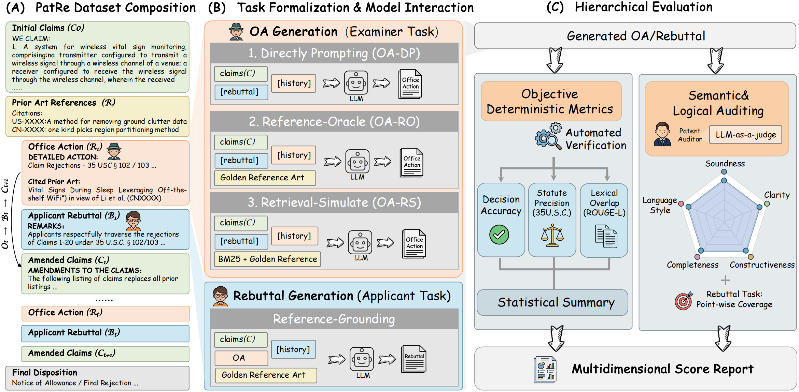

<p align="center">
  
</p>

<h3 align="center"><strong>PatRe</strong>: A Full-Stage Office Action and Rebuttal Generation <br> Benchmark for Patent Examination</h3>

<p align="center">
  <a href="wangqiyao.me">Qiyao Wang</a><sup>1,2,*</sup>, Xinyi Chen<sup>3,*</sup>, Longze Chen<sup>1,2</sup>, Hongbo Wang<sup>3</sup>, Hamid Alinejad-Rokny<sup>4</sup>, Yuan Lin<sup>3,†</sup>, Min Yang<sup>1,5,†</sup>
</p>

<p align="center">
  <sup>1</sup>SIAT-NLP, <sup>2</sup>UCAS, <sup>3</sup>DUT-IR, <sup>4</sup>UNSW Sydney and <sup>5</sup>SUAT
</p>

<p align="center">
  <sup>*</sup> Equal Contribution &nbsp;&nbsp; <sup>†</sup> Corresponding Authors
</p>

<p align="center">
  <a href="https://patre.wangqiyao.me/">🌐 Homepage</a> |
  <a href="">🤗 Dataset</a> |
  <a href="https://arxiv.org/pdf/">📖 Paper</a> |
  <a href="https://huggingface.co/papers/">🤗 HuggingFace Paper</a> |
  <a href="https://github.com/AIforIP/PatRe">GitHub</a>
</p>


This repo contains the evaluation code for the paper "[PatRe: A Full-Stage Office Action and Rebuttal Generation Benchmark for Patent Examination](https://arxiv.org/pdf/)"

## 🔔 News

- 😄 [2026-04-24] Releasing [Website](https://patre.wangqiyao.me/).
- 🔥 [2026-02-16] Research Begining.

## 📅 Timeline

- [x] Code
- [ ] Dataset
- [ ] Software Demostration

## 📝 Introduction





## 🚀 Quick Start

Requirements:
- Python 3.9+ recommended

Install dependencies:

```bash
pip install -r requirements.txt
export PYTHONPATH=$pwd
```

### API Configuration

Use environment variables only (recommended). No API keys need to be written into YAML.

Create `.env` in the project root (you can copy from `.env.example`):

```bash
cp .env.example .env
```

Then fill values in `.env` (minimum required):

```env
OPENAI_API_KEY=YOUR_KEY
OPENAI_BASE_URL=YOUR_BASE_URL
```

Optional (if judge uses different credentials/endpoint):

```env
JUDGE_OPENAI_API_KEY=YOUR_JUDGE_KEY
JUDGE_OPENAI_BASE_URL=YOUR_JUDGE_BASE_URL
```

### Data & Paths

Configure paths in [eval_config.yaml](config/eval_config.yaml):
- `paths.test_set` (e.g., `dataset/processed/test_set_new.json` — a formatted JSON **array** of samples; legacy JSONL is still supported when loading)
- `paths.reference_pool` (e.g., `dataset/ReferencePool_Full`)
- `paths.results` (default: `results/`)

Build the aligned test set:

```bash
python src/data_alignment.py
```

**BM25 in alignment ([src/data_alignment.py](src/data_alignment.py))**: `data_alignment.py` will always compute BM25 over [dataset/ReferencePool_Full](dataset/ReferencePool_Full) and write the results to each sample’s `input.bm25_reference_summaries` (BM25 TOP-K defaults to 5 in the script).

The BM25 query is the aligned sample’s `claims`, and the retrieved reference text will prefer full `claims` when available (falling back to `abstract` otherwise). It applies the same **temporal pool filter** as retrieval: only references whose parsed date is strictly before the sample’s `meta.oa_date` (see [src/ref_pool_dates.py](src/ref_pool_dates.py)). (`rank_bm25` is recommended; a fallback implementation is used if it's not installed.)

At inference with `--retrieval bm25_retrieved`, the evaluator merges these BM25 entries with examiner-oracle references into one deduplicated candidate pool (up to 10 items) for the model prompt—not BM25 alone.


## ✍️ Experiment

Run a minimal OA experiment (1 sample):

```bash
python run_exp.py --task oa --ipc A --num_samples 1
```

Generate-only (skip evaluation):

```bash
python run_exp.py --task oa --generate_only
```

Resume generation in an existing results directory (skip patents that already have non-empty `output/ai_output.txt`; with full pipeline, also skip when `eval/scores.json` exists). Re-run with the **same** `--task`, filters, and data slice as the original run.

```bash
python run_exp.py --task oa --generate_only --resume_dir results/YOUR_EXPERIMENT_DIR
```

Eval-only:

```bash
python run_exp.py --eval_only --results_dir results/YOUR_EXPERIMENT 
```

Force re-evaluation (overwrite by recomputing and writing new scores):

```bash
python run_exp.py --eval_only --results_dir results/YOUR_EXPERIMENT --eval_force
```

Multi-round simulation (OA + rebuttal alternating):

```bash
python run_exp.py
```

### 📖 Configuration Tips

- `--task {oa|rebuttal|both}`: run OA only, rebuttal only, or full multi-round
- `--ipc A-H`: filter by IPC category
- `--num_samples N`: limit number of samples evaluated/generated
- `--generate_only`: generation without evaluation
- `--eval_only --results_dir DIR`: evaluate existing results
- `--eval_limit N`: evaluate only the first N round directories in eval-only mode
- `--test_mode {zero_shot|sft_model}`: override testing mode
- `--retrieval {no_ref|oracle_summary|bm25_retrieved}`: override retrieval setting
- **BM25 temporal filter**: for `bm25_retrieved`, the pool is restricted to ReferencePool documents whose parsed date is **strictly before** the sample’s `meta.oa_date` (same rule when precomputing in `data_alignment.py`). Which JSON keys are used for pool dates is documented in [src/ref_pool_dates.py](src/ref_pool_dates.py).
- `--backend {api|vllm|ollama}`: switch the model backend

### vLLM / Ollama Backends

To use vLLM, you must both:
- start a vLLM server exposing an OpenAI-compatible endpoint (usually under `/v1`)
- run PatRe with `--backend vllm`

Example (PatRe side):

```bash
python run_exp.py --backend vllm
```

The base URL for vLLM is configured in `models.vllm_base_url` in [eval_config.yaml](config/eval_config.yaml).

### Output Structure

PatRe writes results under the experiment directory, grouped by patent and rounds.

Typical layout (new structure):

```text
results/<experiment_name>/
  patent_<PATENT_ID>/
    round_01_oa/
      input/
        ai_input.json
      output/
        ai_output.txt
      eval/
        context.json
        scores.json
        scores_summary.json
```

Eval-only compatibility:
- If `eval/context.json` exists, it will be used.
- If only legacy `context.json` exists, it will be used.
- If no context file exists, PatRe will attempt to reconstruct evaluation context from `paths.test_set` and the round folder name.


## Score Aggregation

Score aggregation (mean metrics across all `eval/scores_summary.json` under one experiment directory):

```bash
python aggregate_scores.py --root results/YOUR_EXPERIMENT --out results/YOUR_EXPERIMENT/metrics_mean_by_task.csv
```

`run_exp.py` also tries to run this aggregation automatically after evaluation, unless `task_settings.auto_run_aggregate_scores` is set to `false` in `config/eval_config.yaml`.

## Troubleshooting

- Environment variables not applied on Windows: `setx` requires opening a new terminal; use `set` for current session.
- `FAILED_TO_GENERATE`: check rate limits, model name, context length; try `PATRE_DRY_RUN=1` to validate the pipeline.
- Similarity metrics are `null`: verify `rouge-score`, `sacrebleu`, `bert-score` are installed and that `ground_truth` is available.

## Citation

When citing this work, please use the following BibTeX entry:

```bibtex

```

## Contact
Feel free to contact the author with `wangqiyao25@mails.ucas.ac.cn`.
